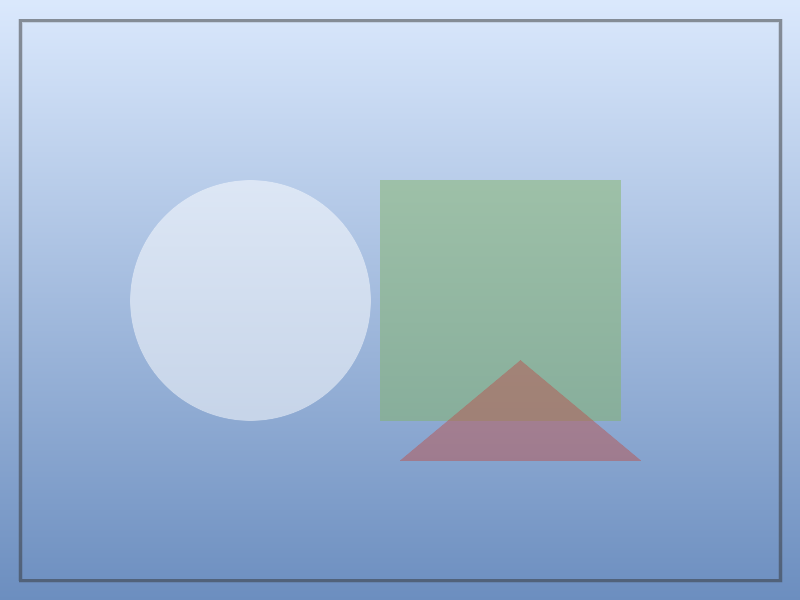

---
# Required
title: |
  Title Of The Thesis\
  Second Line
author:                       # one or more students, listed beneath each other
  - name: First Student
    id: "000001"              # optional student ID, printed under the name
  - Second Student            # a plain name works too
advisor: Advisor Name         # a string or a list
academic-year: 2025/2026

# Optional (shown with their defaults where there is one)
coadvisor: Co-advisor Name    # block is omitted when absent
degree: Master's Degree in Computer Science
subtitle: An Optional Subtitle
# university: University of Camerino
# school: School of Science and Technology
# logo: path/to/logo.png      # default: the Camerino crest shipped with the kit
# lang: en-GB
# fontsize: 11pt              # any pandoc LaTeX variable (geometry, classoption, ...) works
# toc: true                   # contents; likewise lof, lot and lol (list of listings)
# toc-depth: 2
# table-style: grid           # or plain (Pandoc's own booktabs look)
# student-label: Student      # all title page labels can be overridden, see unicam-meta.lua
bibliography: bibliography.bib      # APA via citeproc; override with csl: file.csl
index: true                   # print an index; mark entries with [term]{.index}
---

# Acknowledgements {.acknowledgements}

I thank...

# Introduction {#sec:intro}

Lorem ipsum dolor sit amet, consectetur adipisci elit, sed do eiusmod tempor incidunt ut labore et dolore magna aliqua. Ut enim ad minim veniam, quis nostrum exercitationem ullamco laboriosam, nisi ut aliquid ex ea commodi consequatur. Duis aute irure reprehenderit in voluptate velit esse cillum dolore eu fugiat nulla pariatur. Excepteur sint obcaecat cupiditat non proident, sunt in culpa qui officia deserunt mollit anim id est laborum.

In Chapter [-@sec:intro] we first illustrate the motivation behind the goal described, and then the structure of the thesis.

## Motivation

## Goals

## Structure of the Thesis

# Example Chapter {#sec:chapter2}

Lorem ipsum dolor sit amet, consectetur adipisci elit, sed do eiusmod tempor incidunt ut labore et dolore magna aliqua. Ut enim ad minim veniam, quis nostrum exercitationem ullamco laboriosam, nisi ut aliquid ex ea commodi consequatur.

In this chapter we will discuss ...

## Example Section

The one in @fig:placeholder (example of a reference to a figure) ...

{#fig:placeholder width=50%}

Example of a bullet list ...

- item 1
- item 2
- item 3

A draw.io diagram is embedded by pointing at its `.drawio` file; it is exported to PDF on every build (@fig:pipeline).

{#fig:pipeline width=90%}

## Section 2

Example of a citation from the bibliography [@MP]. Terms can enter the index: [WebSocket]{.index} handshakes, or a different entry like [the handshake]{index="WebSocket!handshake"}.

### Example Subsection

### Example Subsection

```{#lst:handshake .http caption="Example listing"}
GET /chat HTTP/1.1
Host: server.example.com
Upgrade: websocket
Connection: Upgrade
Sec-WebSocket-Key: dGhlIHNhbXBsZSBub25jZQ==
Origin: http://example.com
Sec-WebSocket-Protocol: chat, superchat
Sec-WebSocket-Version: 13
```

| Version | Chrome | Firefox | Internet Explorer | Opera | Safari |
|:--|:--|:--|:--|:--|:--|
| 76 | 6 | 4.0 | No | 11.00 (disabled) | 5.0.1 |
| 7 | No | 6.0 | No | No | No |
| 10 | 14 | 7.0 | HTML5 Labs | ? | ? |
| RFC 6455 | 16 | 11.0 | 10 | 12.10 | 6.0 |

: Example table {#tbl:browser}

| Version | Android | Firefox Mob. | IE Mob. | Opera | Safari |
|:--|:--|:--|:--|:--|:--|
| 76 | ? | ? | ? | ? | ? |
| RFC 6455 | 16 | 11.0 | ? | 12.10 | 6.0 |

: Example table {#tbl:mobile}

@tbl:browser and @tbl:mobile show, for desktop and mobile respectively, which browsers support which version of the WebSocket protocol.[^1]

[^1]: <https://github.com/example/repository>

# Conclusions and Future Work

# Appendix A {.appendix}

Appendix text.

## Appendix Section

More.
